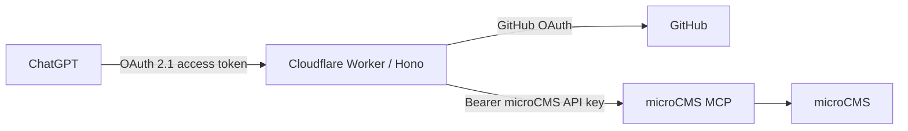

# ChatGPT microCMS MCP Proxy 実装・デプロイ報告

## 結論

Cloudflare Workers 上に、ChatGPT から microCMS 公式 MCP を OAuth 経由で利用するための MCP reverse proxy を実装し、production へデプロイしました。

- MCP URL: `https://chatgpt-microcms-proxy.namiyama814.workers.dev/mcp`
- GitHub OAuth callback URL: `https://chatgpt-microcms-proxy.namiyama814.workers.dev/auth/github/callback`
- 実装方式: Cloudflare Workers + Hono + `@cloudflare/workers-oauth-provider`
- upstream: 固定の `https://mcp.microcms.io/mcp/anzdrop`

## 実装した構成



Worker は microCMS MCP の tool を再実装していません。認証済み MCP request を fixed upstream へ Streamable HTTP のまま転送する薄い reverse proxy です。

## 実装済み要件

| 区分 | 実装内容 |
| --- | --- |
| MCP OAuth | OAuth 2.1 Authorization Server、PKCE S256、RFC 9728 Protected Resource Metadata、RFC 8414 Authorization Server Metadata を実装。 |
| Client 登録 | Dynamic Client Registration (DCR) endpoint を提供。ChatGPT の現行 CIMD は `private_key_jwt` を要求し、採用 library の CIMD public-client 制約と互換しないため DCR を使用。 |
| GitHub 認証 | GitHub OAuth login 後、GitHub `login` が許可 username と完全一致する場合のみ token を発行。 |
| 同意・CSRF | 初回 client 接続時の同意画面、短命 KV state、`__Host-` Secure / HttpOnly / SameSite cookie、state binding を実装。 |
| secret 管理 | microCMS API key、GitHub OAuth credentials、cookie signing key は Cloudflare Worker Secret として登録。Git に含めない。 |
| MCP proxy | `GET` / `POST` / `DELETE` を転送。request / response body を JSON 化・バッファリングせず streaming を維持。 |
| header 制御 | `MCP-Protocol-Version`、`MCP-Session-Id`、`Last-Event-ID` 等を透過。ChatGPT OAuth token、Cookie、forwarding / Cloudflare header は upstream から除外し、microCMS API key の Authorization のみを付与。 |
| SSRF / open proxy 対策 | upstream URL は Worker 内部で Service ID から固定生成。利用者が URL / host を指定する経路はない。 |
| エラー | upstream の HTTP status と body を透過。Worker 自身の設定・到達不能エラーは secret を含まない 5xx として区別。 |
| 公開 repo 整備 | `.gitignore`、`.dev.vars.example`、MIT License、`SECURITY.md`、`CONTRIBUTING.md`、Dependabot、lint/typecheck/test CI を追加。 |

## Cloudflare 設定状況

| 項目 | 状態 |
| --- | --- |
| Worker | デプロイ済み |
| workers.dev | 有効 |
| OAuth KV namespace | 作成・binding 済み |
| `PUBLIC_ORIGIN` | production workers.dev URL に設定済み |
| `MICROCMS_SERVICE_ID` | 設定済み |
| `ALLOWED_GITHUB_USERNAME` | 設定済み |
| `MICROCMS_API_KEY` | Worker Secret として設定済み |
| `GITHUB_CLIENT_ID` | Worker Secret として設定済み |
| `GITHUB_CLIENT_SECRET` | Worker Secret として設定済み |
| `COOKIE_ENCRYPTION_KEY` | ランダム生成し Worker Secret として設定済み |

## 確認結果

| 確認項目 | 結果 |
| --- | --- |
| lint / typecheck / unit test | 成功 |
| Wrangler bundle / deploy | 成功 |
| `/.well-known/oauth-protected-resource/mcp` | production で 200 を確認 |
| `/.well-known/oauth-authorization-server` | production で 200 を確認 |
| 未認証 `GET /mcp` | production で 401 と `WWW-Authenticate` の resource metadata challenge を確認 |
| Hono + Worker binding | production deploy 済み |
| ChatGPT OAuth browser flow | ChatGPT UI 上での最終接続は未実施 |
| `tools/list` / microCMS GET tool | ChatGPT 接続後の最終確認は未実施 |

## 利用開始手順

1. GitHub OAuth App の callback URL を以下に設定する。

   ```text
   https://chatgpt-microcms-proxy.namiyama814.workers.dev/auth/github/callback
   ```

2. ChatGPT で Developer Mode を有効化し、新規 Custom MCP / Plugin を作成する。

3. 以下を指定する。

   | 項目 | 値 |
   | --- | --- |
   | Name | `microCMS` |
   | Server URL | `https://chatgpt-microcms-proxy.namiyama814.workers.dev/mcp` |
   | Authentication | OAuth |

4. GitHub login と同意画面を完了し、tool list と microCMS の GET 系 tool を確認する。

## 残る確認・留意事項

- ChatGPT の実 UI から OAuth flow を完走し、`tools/list` と GET 系 tool を実行する最終受入確認が必要です。
- microCMS API key は現在の GET 権限で検証し、書込み tool を使う場合だけ microCMS 側で最小限の権限を追加します。proxy 側で tool を hard-code 制限しません。
- GitHub OAuth Client Secret と microCMS API key は設定作業中に会話へ入力されたため、運用開始前に GitHub / microCMS 側でローテーションし、新しい値で Cloudflare Worker Secret を更新することを推奨します。
- GitHub OAuth の許可対象は単一 username の完全一致です。複数ユーザーや GitHub Organization 判定が必要になった場合は、明示的な拡張が必要です。
- 本番用 API key と MCP 用 API key は分離を維持し、secret・access token・request header / body をログへ出力しないでください。

## 関連ファイル

- `src/index.ts`: Hono routes と OAuth provider 統合
- `src/auth.ts`: GitHub OAuth、同意、state / cookie 保護
- `src/proxy.ts`: stream-preserving MCP reverse proxy
- `wrangler.jsonc`: Worker / KV / production variables
- `README.md`: 第三者向け導入手順とセキュリティ注意
