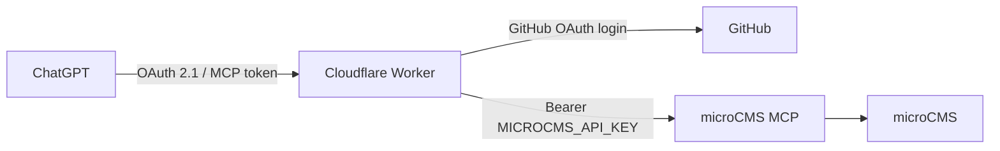

# ChatGPT microCMS MCP Proxy

ChatGPT が OAuth で接続できるよう、HTTP Bearer 認証のみを提供する [microCMS MCP](https://document.microcms.io/en/mcp-server/microcms-mcp) の前に Cloudflare Worker を置くプロジェクトです。Worker は MCP tool を再実装せず、認証済み要求を固定の microCMS endpoint へストリーミング転送するときだけ API key を注入します。

> このプロジェクトは microCMS、OpenAI / ChatGPT、Cloudflare の公式プロジェクトではありません。microCMS MCP はベータ機能で、仕様や tool は変更されることがあります。



## Security model

- `/mcp` は OAuth 2.1、PKCE S256、resource audience 検証で保護されます。
- GitHub の `login` が `ALLOWED_GITHUB_USERNAME` と完全一致する 1 ユーザーだけを許可します。
- Worker は Protected Resource Metadata、Authorization Server Metadata、Client ID Metadata Document (CIMD)、Dynamic Client Registration (DCR) を提供します。
- 接続先は常に `https://mcp.microcms.io/mcp/<MICROCMS_SERVICE_ID>` です。リクエストで URL は指定できず、open proxy / SSRF にはなりません。
- ChatGPT の OAuth token、browser cookie、GitHub OAuth token、Cloudflare forwarding header は microCMS に渡りません。MCP session / protocol header と streaming response は透過します。

## Prerequisites

- Node.js 24 以降、Cloudflare account、GitHub OAuth App を作成できる GitHub account
- microCMS Service ID と MCP 専用 API key
- Custom MCP / Developer Mode が利用できる ChatGPT プランと必要な管理者権限

## Setup and deploy

```sh
git clone https://github.com/namiyama814/chatgpt-microcms-proxy.git
cd chatgpt-microcms-proxy
npm install
npx wrangler login
npx wrangler kv namespace create OAUTH_KV
npx wrangler kv namespace create OAUTH_KV --preview
```

KV 作成結果の production ID と preview ID を [`wrangler.jsonc`](wrangler.jsonc) の `id` / `preview_id` に設定します。次に初回 deploy を行い、表示される `https://<worker-name>.<subdomain>.workers.dev` を `<WORKER_ORIGIN>` とします。

```sh
npx wrangler deploy
```

GitHub の **Settings → Developer settings → OAuth Apps → New OAuth App** で OAuth App を作成します。

| Field | Value |
| --- | --- |
| Homepage URL | `<WORKER_ORIGIN>` |
| Authorization callback URL | `<WORKER_ORIGIN>/auth/github/callback` |

Client Secret を生成してから、以下を登録します。`.dev.vars.example` はローカル環境用の空テンプレートであり、実値を書いた `.dev.vars` は Git に入りません。

```sh
npx wrangler secret put MICROCMS_API_KEY
npx wrangler secret put GITHUB_CLIENT_ID
npx wrangler secret put GITHUB_CLIENT_SECRET
npx wrangler secret put COOKIE_ENCRYPTION_KEY
```

`COOKIE_ENCRYPTION_KEY` は `openssl rand -base64 48` などで生成したランダム値にしてください。Cloudflare dashboard の Worker variables、または `wrangler.jsonc` の `vars` に以下の **非 secret** 値を設定します。

```jsonc
"vars": {
  "MICROCMS_SERVICE_ID": "your-service-id",
  "ALLOWED_GITHUB_USERNAME": "your-github-login",
  "PUBLIC_ORIGIN": "https://your-worker.your-subdomain.workers.dev"
}
```

`PUBLIC_ORIGIN` は HTTPS origin のみで、ChatGPT に登録する URL と完全一致させます。カスタムドメインを使う場合も同様です。workers.dev とカスタムドメインを同時に MCP URL として使う場合は、issuer を一意にするため Worker を分けてください。

```sh
npm run check
npx wrangler deploy
```

## ChatGPT

1. ChatGPT web で Developer Mode を有効にします。
2. Plugins / Custom MCP の新規接続で、Name を `microCMS`、Server URL を `<WORKER_ORIGIN>/mcp`、Authentication を **OAuth** に設定します。
3. GitHub にログインし、`ALLOWED_GITHUB_USERNAME` と一致するアカウントで認可します。
4. 初回の同意画面で ChatGPT client に microCMS MCP 接続を許可します。

ChatGPT は未認証 `/mcp` の 401 challenge から OAuth metadata を自動発見し、`/oauth/register` の Dynamic Client Registration (DCR) で client を自動登録します。client ID / secret の手入力は不要です。

## Verify

```sh
curl -i "<WORKER_ORIGIN>/.well-known/oauth-protected-resource/mcp"
curl -i "<WORKER_ORIGIN>/.well-known/oauth-authorization-server"
curl -i "<WORKER_ORIGIN>/mcp"
```

最後の要求は `401 Unauthorized` と metadata URL を含む `WWW-Authenticate` を返します。ChatGPT 接続後は tool list と GET 系 tool を確認してください。安全なログ確認は `npx wrangler tail` で行えますが、token・API key・header・本文をログへ出力してはいけません。

## Local development and troubleshooting

`.dev.vars.example` を `.dev.vars` にコピーして値を設定し、`npm run dev` を実行します。`__Host-` cookie は Secure 必須なので、ローカル HTTP では GitHub OAuth browser flow を完走できません。E2E 確認には deploy 済み workers.dev URL または HTTPS tunnel を使ってください。

| Symptom | Check |
| --- | --- |
| OAuth が始まらない | `/mcp` の 401 と metadata endpoint、`PUBLIC_ORIGIN` と MCP URL の一致を確認します。 |
| `redirect_uri_mismatch` | GitHub callback URL を `<WORKER_ORIGIN>/auth/github/callback` に完全一致させます。 |
| GitHub login が拒否される | 表示名ではなく GitHub login を `ALLOWED_GITHUB_USERNAME` に設定します。 |
| tool が無い / 401 / 403 | Service ID、MCP 専用 API key、microCMS API key 権限を確認します。 |
| write tool が拒否される | proxy の異常ではありません。microCMS API key に必要な書込み権限を追加します。 |

## Security and contributing

- API key をコードに書かず、本番 API key と MCP API key を分離してください。
- microCMS API key は最小権限にし、まず GET 権限のみで始めてください。
- `ALLOWED_GITHUB_USERNAME` を必ず設定してください。
- 脆弱性は public Issue ではなく [SECURITY.md](SECURITY.md) に従い GitHub Security Advisories から非公開報告してください。
- 開発時は `npm run lint`、`npm run typecheck`、`npm test` を実行します。貢献方法は [CONTRIBUTING.md](CONTRIBUTING.md) を参照してください。

MIT License の下で提供します。
